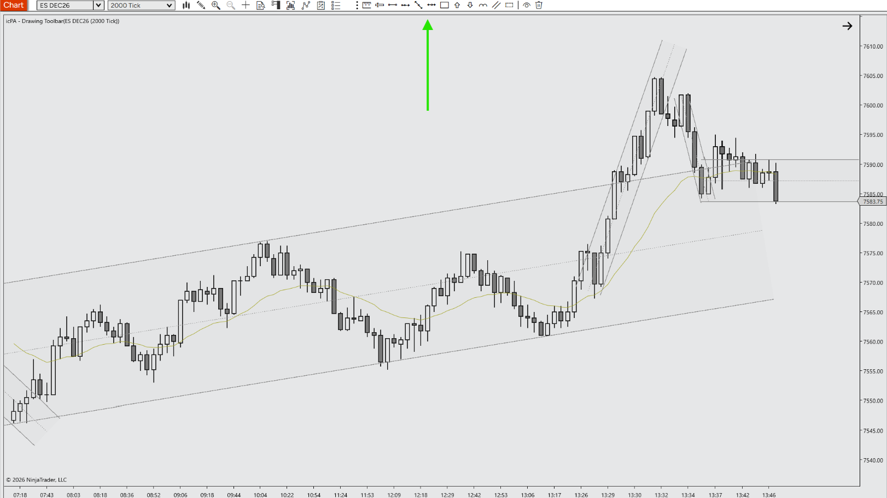

# icPA - Drawing Toolbar for NinjaTrader 8

A specialized Indicator engineered for Price Action day trading. It puts your chosen drawing tools one click away, in a toolbar that floats on the chart or docks in the chart window's own toolbar, with optional buttons to hide/show or delete all your hand-made drawings.

---

## 📺 Video Walkthrough & Setup

Watch the complete breakdown of parameters, price action context, and chart examples on YouTube:

> **[▶ Click here to watch the full YouTube walkthrough](https://youtube.com/@icPriceAction)**

---

## ⚡ Key Features

- **Your tools, your order:** Right-click the grip and choose **Configure tools...** to pick any drawing tool from the chart's drawing tools menu (including third-party ones) and set the order they appear in. Click a button to start drawing.
- **Docked or floating:** Dock the toolbar in the chart window's toolbar (shown only while its own chart tab is selected), or float it on the chart panel, drag it anywhere inside the panel, and drag it past the edge to move it to another panel.
- **Hide/show and delete all drawings:** Optional buttons hide, then restore, all hand-made drawings on the chart, or delete them after a confirmation. Global drawings and drawings created by indicators or strategies are never touched, delete keeps locked drawings, and hide/show only restores the drawings it hid. The hidden state is saved with the workspace.
- **PATS & Context Aligned:** Designed for Price Action principles (Mack / Thomas Wade) and disciplined futures execution: mark trend lines, channels and key levels without hunting through menus.
- **Zero Chart Lag:** Native C# with no per-bar or per-frame work, so it adds no load to high-frequency 2000-tick ES/MES charts.
- **Clean Visuals:** Uses NinjaTrader's own theme colors and icons, so it blends into your chart and toolbar without clutter.
- **Fully Customizable:** Configure docking, offset, layout and the optional buttons via the native NT8 settings panel.

---

## ⚠️ Prerequisites & Data Requirements

- Works on any chart, instrument and bar type. No Tick Replay, Level 2 data or special Calculate mode needed.
- NinjaTrader 8.1 or later.
- The hide/show and delete button icons use the Segoe Fluent Icons (Windows 11) or Segoe MDL2 Assets (Windows 10) font, both included with Windows.

---

## 📥 Installation Guide

1. Head to the **[Releases](https://github.com/icPriceAction/drawing-toolbar/releases)** tab of this repository.
2. Download the latest release `.zip` file (`icPriceAction_icPADrawingToolbar_v1.0.2.zip`).
   - *Note: Do NOT extract or unzip the file.*
3. Open **NinjaTrader 8**.
4. In the Control Center, navigate to:
   `Tools` ➔ `Import` ➔ `NinjaScript Add-On...`
5. Select the downloaded `.zip` file and click **Open**.
6. A success dialog will appear confirming the tool has been imported.
7. Open any chart, press `Ctrl + I`, find **icPA - Drawing Toolbar** in the **icPA** folder, and add it.

### Using the toolbar

- **Click** a tool button to start drawing with that tool.
- **Right-click** the grip (the three dots) and choose **Configure tools...** to pick the tools and their order.
- **Double-click** the grip to open the indicator properties.
- **Floating mode:** drag the grip to move the toolbar; drag it off the panel to move it to another panel.

---

## ⚙️ Parameters & Configuration

| Parameter | Group | Type | Default | Description |
| :--- | :--- | :--- | :--- | :--- |
| Dock in chart toolbar | 1. General | Boolean | True | Show the toolbar in the chart window's toolbar instead of floating on the chart. |
| Toolbar offset (px) | 1. General | Integer (0–3000) | 20 | Space to the left of the docked toolbar, to push it further right in the chart window's toolbar. Shown only when docked. |
| Buttons per column | 1. General | Integer (1–50) | 5 | Number of tool buttons stacked in each column of the floating toolbar. Shown only when floating. |
| Visible only when chart is focused | 1. General | Boolean | False | Hide the floating toolbar while the chart window is not the active window. Shown only when floating. |
| Show hide/show drawings button | 1. General | Boolean | True | Adds a button that hides, then restores, all hand-made drawings on this chart. Global drawings are not affected. |
| Show delete all drawings button | 1. General | Boolean | True | Adds a button that deletes all hand-made drawings on this chart after confirmation. Global and locked drawings are kept. |

**Tools on the toolbar** are set in the **Configure tools...** window (right-click the grip), not in the properties panel. Default tools: Line, Ray, Extended Line, Horizontal Line, Vertical Line, Fibonacci Retracements, Fibonacci Extensions, Rectangle, Ellipse, Text.

---

## 📝 Changelog

- **v1.0.2** (2026-11-03) - Initial public release. Cleaned and optimized by icPriceAction.
- **v1.0.1** - Tool lists in "Configure tools..." scroll when long; the window sizes itself to its content.
- **v1.0.0** - Drawings hidden by the toolbar are shown again when it is removed or the hide/show button is turned off; Segoe Fluent Icons with Segoe MDL2 fallback for action buttons; code cleanup.
- **v0.3.1** - Delete confirmation states that deleting cannot be undone.
- **v0.3.0** - Optional hide/show and delete-all drawing buttons; hidden state saved with the workspace.
- **v0.2.1** - Fixed a compile error in the theme resource helper.
- **v0.2.0** - Rewrite; "Configure tools..." window to choose and order tools; safer tool loading and cleanup.
- **v0.1.0** - Initial version: floating toolbar with optional docking in the chart window's toolbar.

---

## ☕ Support the Project

All tools provided by **icPriceAction** are 100% free and open-source for personal trading use. These tools, even though supported by AI, have taken considerable time to design, build, test and package. If these tools bring you value, consider supporting continued development:

- **Prop Firm Traders:** Use discount code **`ICPAT`** at checkout across top futures prop evaluation firms ([View Active Discounts](https://icpriceaction.com/prop-firms.html)).
- **Profitable Traders:** Send a one-time tip to support my continued support and time, server hosting and open-source updates via [Buy Me a Coffee](https://buymeacoffee.com/icpriceaction).

---

## 🐛 Bug Reports & Feature Requests

Found an issue or have an enhancement idea?
Please submit an issue on the [Issues tab](https://github.com/icPriceAction/drawing-toolbar/issues).

---

## License

Free for personal trading use. Commercial resale, redistribution, or repackaging is strictly prohibited. See [LICENSE](LICENSE).

---

## ⚖️ Disclaimer

Futures trading involves substantial risk of loss and is not suitable for every investor. All indicators, drawing tools, strategies, and documentation provided by **icPriceAction** are for educational and analytical purposes only. Nothing herein constitutes financial or investment advice. Automated strategies can lose money and may behave differently in live markets than in simulation or backtests.

NinjaTrader® is a registered trademark of NinjaTrader, LLC. icPriceAction is an independent developer with no official affiliation to NinjaTrader, LLC.